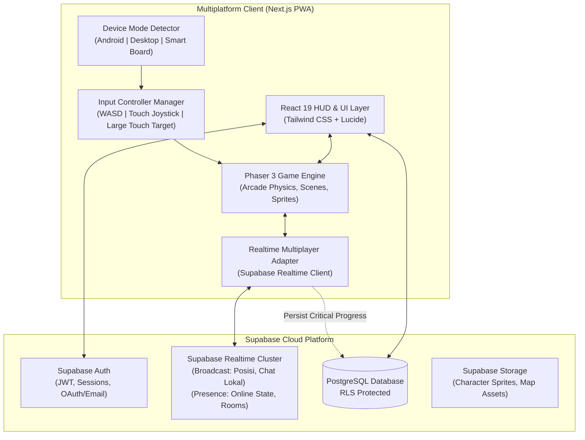

# SYSTEM ARCHITECTURE: INDONESIAN LIFE RP

**Document:** Software Architecture Specification  
**Status:** Approved for Implementation  
**Project:** Indonesian Life RP  
**Stack:** Next.js (App Router), React 19, TypeScript 5, Phaser 3, Supabase Realtime & PostgreSQL  

---

## 1. High-Level Architectural Diagram



---

## 2. Layer Separation & Directory Structure

Untuk memastikan kode modular dan tidak ada file monolitik ribuan baris, sistem disusun dalam struktur direktori berikut:

```
src/
├── app/
│   └── game/                        # Next.js Page Route untuk Indonesian Life RP
│       ├── page.tsx                 # Entry Point Halaman Game (Client Component SSR=false)
│       ├── layout.tsx               # Standalone Fullscreen PWA Layout
│       └── loading.tsx              # Loading Screen Awal
├── game/                            # Core Phaser 3 Game Engine
│   ├── config/                      # Konfigurasi Phaser (Resolusi, Skala, Physics, Renderer)
│   │   └── phaser.config.ts
│   ├── scenes/                      # Scene Manajemen Permainan
│   │   ├── BootScene.ts             # Preload Aset Pokok & Shader
│   │   ├── MainTownScene.ts         # Peta Kota Utama Nusantara Asri
│   │   └── InteriorScene.ts         # Scene Interior Gedung (Sekolah, Warung, Rumah)
│   ├── entities/                    # Entitas Permainan
│   │   ├── Player.ts                # Karakter Pemain Lokal (Movement, Collision, Anim)
│   │   ├── RemotePlayer.ts          # Karakter Pemain Lain (Interpolasi Realtime)
│   │   └── Npc.ts                   # Karakter Non-Player (Dialog, Interaksi)
│   ├── systems/                     # Sub-Sistem Permainan
│   │   ├── InteractionManager.ts    # Deteksi Jarak Objek & Trigger Aksi
│   │   ├── DayNightCycle.ts         # Siklus Waktu Siang & Malam
│   │   └── CameraController.ts      # Pengendalian Kamera Dinamis
│   └── input/                       # Adaptor Kontrol Input Multi-Platform
│       ├── InputManager.ts          # Abstraksi Pengontrol Input
│       ├── KeyboardController.ts    # Input Mode Desktop (WASD + Shortcuts)
│       └── TouchJoystick.ts         # Input Mode Android & Papan Interaktif
├── components/game/                 # React UI Overlay (HUD, Chat, Dialog, Inventory)
│   ├── GameContainer.tsx            # Pembungkus Kanvas Phaser di React
│   ├── GameHUD.tsx                  # Status Pemain, Jam Kota, Mini Map
│   ├── VirtualControls.tsx          # Joystick Layar Sentuh & Tombol Aksi
│   ├── ChatOverlay.tsx              # Kotak Obrolan Lokal & Global
│   ├── InteractionPrompt.tsx        # Indikator Tombol Interaksi (Floating)
│   └── DialogBox.tsx                # Antarmuka Percakapan NPC / Misi
├── lib/
│   └── game/                        # Layanan Bisnis & Database Game
│       ├── types.ts                 # Definisi Tipe TypeScript Permainan
│       ├── deviceDetector.ts        # Layanan Deteksi Perangkat (Android/Desktop/Board)
│       ├── multiplayerService.ts    # Abstraksi Supabase Realtime (Broadcast & Presence)
│       └── characterService.ts      # Integrasi Database Supabase untuk Karakter
└── supabase/
    └── migrations/                  # Skrip Migrasi SQL Skema & RLS
        └── 20261102_indonesian_life_rp_init.sql
```

---

## 3. Multiplayer Realtime Architecture (Supabase Realtime)

Protokol jaringan multiplayer dirancang sangat efisien agar tidak membebani database:

1. **Broadcast Channels (Pertukaran Data Cepat / Posisi)**:
   - Posisi karakter dikirimkan melalui channel Broadcast Supabase Realtime dengan frekuensi adaptif ($10 - 15 \text{ tick/detik}$).
   - Client penerima menerapkan **Linear Interpolation (LERP)** dan *dead reckoning* untuk menghaluskan pergerakan pemain lain pada 60 FPS tanpa jeda patah-patah.
   - **Aturan Tegas**: Posisi karakter per frame **TIDAK PERNAH** ditulis ke tabel PostgreSQL!
2. **Presence Channels (Status Online & Sinkronisasi Room)**:
   - Digunakan untuk mendeteksi siapa saja pemain yang sedang berada dalam radius/room kota yang sama.
   - Menyediakan metadata pemain: `user_id`, `character_name`, `gender`, `skin_color`, `clothing_id`, `holding_item`.
   - Mengelola otomatis event `join` dan `leave` saat pemain keluar atau koneksi terputus.
3. **Database Transaksional (Hanya Data Permanen Penting)**:
   - Penyimpanan uang virtual, perpindahan item inventori, kepemilikan properti, dan kenaikan pangkat pekerjaan dieksekusi melalui **Server Actions / PostgreSQL RPC** dengan verifikasi keamanan ketat.

---

## 4. Multiplatform Device Detection Architecture

```typescript
export type DeviceMode = 'android' | 'desktop' | 'interactive_board';

export class DeviceDetector {
  static detectMode(): DeviceMode {
    if (typeof window === 'undefined') return 'desktop';
    
    const isTouch = 'ontouchstart' in window || navigator.maxTouchPoints > 0;
    const width = window.innerWidth;
    const height = window.innerHeight;
    const userAgent = navigator.userAgent.toLowerCase();
    
    // Deteksi Papan Interaktif (Interactive Flat Panel / Smart Board):
    // Layar sentuh dengan resolusi besar (>= 1280px) landscape tanpa OS mobile khas
    const isLargeScreen = width >= 1280 && width > height;
    const isMobileOS = /android|iphone|ipad|ipod/.test(userAgent);
    
    if (isTouch && isLargeScreen && !isMobileOS) {
      return 'interactive_board';
    }
    
    if (isTouch || isMobileOS) {
      return 'android';
    }
    
    return 'desktop';
  }
}
```

---

## 5. Database Schema & RLS Strategy

Tabel didesain modular di Supabase PostgreSQL dengan proteksi Row Level Security (RLS):

1. **`characters`**: Menyimpan profil karakter, penampilan, posisi spawn awal terakhir, dan relasi ke `auth.users`.
2. **`player_wallets`**: Menyimpan saldo uang virtual (Rupiah Game) dengan RLS ketat; perubahan saldo hanya dapat dilakukan via fungsi tersimpan (*stored procedure*) server-side.
3. **`player_inventory`**: Item yang dimiliki pemain (makanan, minuman, kunci rumah, berkas kerja).
4. **`game_rooms`**: Ruang dunia kota aktif untuk pengelompokan pemain di Supabase Realtime.
5. **`chat_messages`**: Riwayat obrolan global penting / pesan tersimpan.

---

## 6. Performance & Rendering Guardrails

1. **Next.js & Phaser Isolation**:
   - Kanvas Phaser dimuat secara eksklusif di sisi klien (*client-side only*) menggunakan dynamic import `ssr: false` agar terhindar dari error server `window is not defined`.
2. **Texture Memory Management**:
   - Seluruh sprite menggunakan texture atlas terkompresi. Tidak ada pemanggilan gambar berat dalam format Base64 ke dalam database.
3. **PWA Standalone & Viewport Scaling**:
   - Game canvas menggunakan mode `Phaser.Scale.FIT` dengan orientasi responsif untuk menjaga rasio aspek 16:9 stabil di desktop, tablet, dan ponsel.

